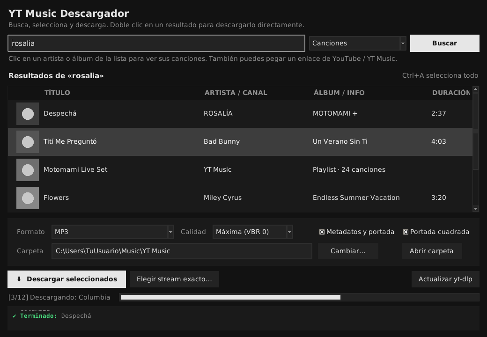

# 🎵 YT Music Descargador

Una aplicación para Windows que te deja **buscar canciones, álbumes y playlists de YouTube Music y descargarlas** en tu ordenador con un par de clics, sin escribir comandos.

Por dentro usa [yt-dlp](https://github.com/yt-dlp/yt-dlp), la herramienta más conocida para descargar de YouTube, pero tú no tienes que saber nada de ella: la app hace todo el trabajo.



---

## ✨ Qué puedes hacer

- 🔍 **Buscar** canciones, álbumes, playlists o vídeos directamente desde la app.
- 👤 **Buscar las playlists de un canal**: escribes el nombre del canal y ves todas sus playlists públicas.
- 🖼️ Ver la **portada** de cada resultado.
- 🎤 Hacer **clic en un artista** para ver todas sus canciones, o **en un álbum** para ver sus pistas.
- ⬇️ **Descargar** una canción, varias a la vez, un álbum entero o una playlist completa.
- 🎚️ Elegir el **formato** (MP3, M4A, FLAC, OPUS, WAV…) y la **calidad**.
- 🏷️ Los archivos se guardan con su **título, artista, álbum y portada**, para que se vean bien en tu reproductor de música.
- 🔄 **Se actualiza sola**: cada vez que la abres comprueba si hay una versión nueva del motor de descarga.
- 📦 **No hay que instalar nada**: lo necesario viene incluido.

---

## ⬇️ Cómo instalarla (3 pasos)

### 1. Descarga la aplicación

Entra en la página de descargas y pulsa en **`YT-Music-Descargador-Windows.zip`**:

👉 **[Descargar la última versión](https://github.com/berkro/ytmusic-downloader/releases/latest)**

> Ocupa unos 150–200 MB, porque incluye todo lo necesario para funcionar.

### 2. Descomprime el archivo

1. Ve a la carpeta **Descargas** de tu ordenador.
2. Haz **clic derecho** sobre `YT-Music-Descargador-Windows.zip` → **Extraer todo…**
3. Elige dónde guardarla, por ejemplo en **Documentos**, y pulsa **Extraer**.

> ⚠️ **No la pongas en «Archivos de programa» (`C:\Program Files`).** La app necesita poder actualizarse a sí misma, y Windows no le deja modificar archivos en esa carpeta.

### 3. Ábrela

Dentro de la carpeta que has extraído, haz **doble clic** en **`YT Music Descargador.exe`**.

💡 **Consejo:** para tenerla siempre a mano, haz clic derecho sobre el `.exe` → **Mostrar más opciones** → **Enviar a** → **Escritorio (crear acceso directo)**.

### ❗ Si Windows dice «Windows protegió tu PC»

Es normal la primera vez. Sale con cualquier programa que no venga de una gran empresa que paga a Microsoft para firmar sus aplicaciones. No significa que tenga un virus.

1. Pulsa **Más información**.
2. Pulsa **Ejecutar de todas formas**.

Solo tendrás que hacerlo una vez.

---

## 🎧 Cómo se usa

### Buscar música

1. Escribe lo que buscas en la barra de arriba.
2. En el desplegable de la derecha elige **qué** quieres buscar:

   | Opción | Para qué sirve |
   |---|---|
   | **Canciones** | Buscar temas sueltos |
   | **Álbumes** | Buscar discos completos |
   | **Playlists** | Buscar listas por su nombre |
   | **Playlists de un canal** | Ver todas las listas públicas de un canal o usuario |
   | **Vídeos** | Buscar vídeos musicales, directos, etc. |

3. Pulsa **Buscar** o la tecla **Enter**.

> 🔗 También puedes **pegar un enlace** de YouTube o YouTube Music en la barra de búsqueda y pulsar Buscar. Aparecerá en la lista, listo para descargar.

### Ver las canciones de un artista o de un álbum

- Haz **clic en el nombre del artista** (columna *Artista / Canal*) para ver **todas sus canciones**.
- Haz **clic en el nombre del álbum** (columna *Álbum / Info*) para ver **todas sus pistas**.
- Cuando el ratón está encima de algo donde se puede hacer clic, el cursor se convierte en una **mano** 👆.
- Para volver a donde estabas, pulsa **← Volver** (o la tecla **Retroceso** ⌫).

### Descargar

1. **Selecciona** lo que quieras descargar haciendo clic en el **título** o en la **portada**:
   - Para seleccionar **varios**, mantén pulsada la tecla **Ctrl** mientras haces clic.
   - Para seleccionar **todo**, pulsa **Ctrl + A**.
2. Pulsa **⬇ Descargar seleccionados**.
   - Atajo: haz **doble clic** sobre una canción para descargarla directamente.
3. Abajo verás el progreso:
   - ✔ **Terminado** en **verde** → descargada correctamente.
   - ✖ **ERROR** en **rojo** → algo ha fallado (mira la sección *Problemas frecuentes*).

Pulsa **Abrir carpeta** para ver tus canciones.

### ¿Qué formato elijo?

| Formato | Cuándo elegirlo |
|---|---|
| **MP3** | ✅ **La opción recomendada.** Funciona en todos los dispositivos, coches y reproductores. |
| **M4A (AAC)** | Algo mejor calidad que el MP3 con el mismo tamaño. Ideal para iPhone, iTunes y Apple Music. |
| **Original (sin recodificar)** | Guarda el audio tal cual lo da YouTube (normalmente OPUS o M4A), sin perder nada en la conversión. |
| **OPUS** / **OGG Vorbis** | Formatos muy eficientes. Para usuarios avanzados. |
| **FLAC** / **ALAC** / **WAV** | Formatos "sin pérdida". Ver la nota de abajo. |

> 💡 **Sobre FLAC y WAV:** YouTube nunca da el audio en calidad sin pérdida, así que convertir a FLAC o WAV **no mejora el sonido**; solo hace el archivo mucho más grande. Úsalos solo si un programa o aparato concreto te los pide.

**Calidad:** deja **Máxima** salvo que quieras archivos más pequeños. En los formatos sin pérdida y en «Original» no se puede elegir, porque no hace falta.

### Otras opciones

- **Metadatos y portada:** guarda dentro del archivo el título, artista, álbum y la carátula. Se usa la **carátula oficial de YouTube Music** (la misma que ves en la app); si una canción no la tiene, se usa la imagen del vídeo. Déjalo activado.
- **Portada cuadrada:** solo se nota cuando no hay carátula de YouTube Music: recorta la imagen del vídeo para que quede cuadrada. Déjalo activado.
- **Carpeta:** dónde se guardan las descargas. Pulsa **Cambiar…** para elegir otra.

La app recuerda todas estas opciones para la próxima vez.

### Cómo se organizan los archivos

```
📁 Music\YT Music\
   ├── ROSALÍA - Despechá.mp3                 ← canciones sueltas
   ├── 📁 ROSALÍA - MOTOMAMI\                  ← un álbum
   │     ├── 01 - ROSALÍA - SAOKO.mp3
   │     └── 02 - ROSALÍA - CANDY.mp3
   └── 📁 Mi playlist\                         ← una playlist
         ├── 01 - Artista - Canción.mp3
         └── ...
```

### Elegir stream exacto (avanzado)

YouTube guarda cada canción en varias versiones con distinta calidad. Selecciona **una** canción y pulsa **Elegir stream exacto…** para ver todas las versiones disponibles (códec, kbps, tamaño) y descargar la que prefieras. La mayoría de la gente no lo necesita: la app ya elige la mejor automáticamente.

---

## 🔄 Actualizaciones

YouTube cambia su web a menudo, y cuando lo hace, los programas de descarga dejan de funcionar hasta que se actualizan. Por eso:

- **Cada vez que abres la app**, comprueba sola si hay una versión nueva del motor de descarga (yt-dlp) y la instala. En el registro de abajo verás *«yt-dlp al día»* o *«yt-dlp actualizado a…»*.
- Si alguna descarga empieza a fallar, pulsa **Actualizar yt-dlp** para forzar la comprobación.
- Para tener una **versión nueva de la propia app**, vuelve a descargar el `.zip` desde [Releases](https://github.com/berkro/ytmusic-downloader/releases/latest) y sustituye la carpeta antigua.

---

## ❓ Problemas frecuentes

<details>
<summary><b>Las descargas fallan con un ERROR en rojo</b></summary>

1. Pulsa **Actualizar yt-dlp** y vuelve a intentarlo. En la mayoría de los casos esto lo arregla.
2. Si pone *«Video unavailable»*, esa canción no está disponible en tu país o la han borrado.
3. Si pone *«Sign in to confirm your age»*, el vídeo tiene restricción de edad y no se puede descargar sin iniciar sesión.
</details>

<details>
<summary><b>Pone «No se pudo actualizar yt-dlp»</b></summary>

Lo más probable es que la carpeta de la app esté en un sitio protegido (como `C:\Program Files`). Muévela a **Documentos** o al **Escritorio**. También puede pasar si no tienes conexión a internet.
</details>

<details>
<summary><b>No encuentro mi playlist</b></summary>

- Las playlists **privadas** no aparecen en ninguna búsqueda. En YouTube Music, cambia la playlist a **Pública** u **Oculta**, copia su enlace y pégalo en la barra de búsqueda.
- Prueba la opción **Playlists de un canal** escribiendo el nombre de tu canal.
</details>

<details>
<summary><b>No se ven las portadas en la lista</b></summary>

Se cargan unos segundos después de los resultados. Si no aparecen nunca, revisa tu conexión o el antivirus.
</details>

<details>
<summary><b>El antivirus borra o bloquea la app</b></summary>

Algunos antivirus desconfían de los programas hechos con Python aunque sean inofensivos (es un "falso positivo"). Añade la carpeta de la app a las **exclusiones** de tu antivirus. El código es público: puedes revisarlo en este repositorio.
</details>

<details>
<summary><b>¿Funciona en Mac o Linux?</b></summary>

La versión descargable es solo para Windows. En Mac o Linux puedes ejecutarla desde el código (ver la sección *Para desarrolladores*).
</details>

---

## 📁 Qué hay dentro de la carpeta

| Archivo | Qué es |
|---|---|
| `YT Music Descargador.exe` | La aplicación. |
| `_internal\` | Archivos internos de la aplicación. No los toques. |
| `bin\yt-dlp.exe` | El motor que descarga de YouTube. Se actualiza solo. |
| `bin\ffmpeg.exe`, `bin\ffprobe.exe` | Convierten el audio al formato que elijas y ponen la portada. |
| `bin\deno.exe` | Lo necesita yt-dlp para que YouTube le deje descargar. |

Tus opciones se guardan en `C:\Users\TuUsuario\.ytmusic_descargador.json`.

---

## 🛠️ Para desarrolladores

### Ejecutar desde el código

Necesitas [Python](https://www.python.org/downloads/) 3.11 o superior, además de [ffmpeg](https://ffmpeg.org/) y [deno](https://deno.com/) en el PATH:

```bash
py -m pip install -r requirements.txt "yt-dlp[default]"
py ytmusic_descargador.py
```

La app busca `yt-dlp`, `ffmpeg` y `deno` primero en una carpeta `bin` junto al script y, si no están, en el PATH.

### Cómo se genera el .exe

Cada vez que se sube un cambio a la rama `main`, [GitHub Actions](.github/workflows/compilar.yml) hace esto automáticamente:

1. Empaqueta la app con **PyInstaller** (incluye Python, ytmusicapi, Pillow y Mutagen).
2. Descarga las últimas versiones oficiales de **yt-dlp.exe**, **ffmpeg** ([yt-dlp/FFmpeg-Builds](https://github.com/yt-dlp/FFmpeg-Builds)) y **deno** en la carpeta `bin`.
3. Comprueba que todo arranca.
4. Lo comprime y lo publica en **Releases** como «Última versión».

También se puede lanzar a mano desde la pestaña **Actions** → *Compilar para Windows* → **Run workflow**.

### Proyectos que usa

- [yt-dlp](https://github.com/yt-dlp/yt-dlp): descarga y conversión
- [ytmusicapi](https://github.com/sigma67/ytmusicapi): búsqueda en YouTube Music
- [FFmpeg](https://ffmpeg.org/): procesado de audio
- [Deno](https://deno.com/): motor de JavaScript que necesita yt-dlp
- [Pillow](https://python-pillow.org/): portadas en la lista
- [Mutagen](https://github.com/quodlibet/mutagen): carátulas dentro de los archivos

---

## ⚖️ Aviso legal

Esta herramienta es para **uso personal**. Descarga solo contenido que tengas derecho a guardar, como música libre de derechos, tus propias subidas o contenido cuya licencia lo permita. Descargar contenido protegido puede ir en contra de las [condiciones de uso de YouTube](https://www.youtube.com/t/terms) y de las leyes de propiedad intelectual de tu país. El uso que hagas de la aplicación es responsabilidad tuya.
